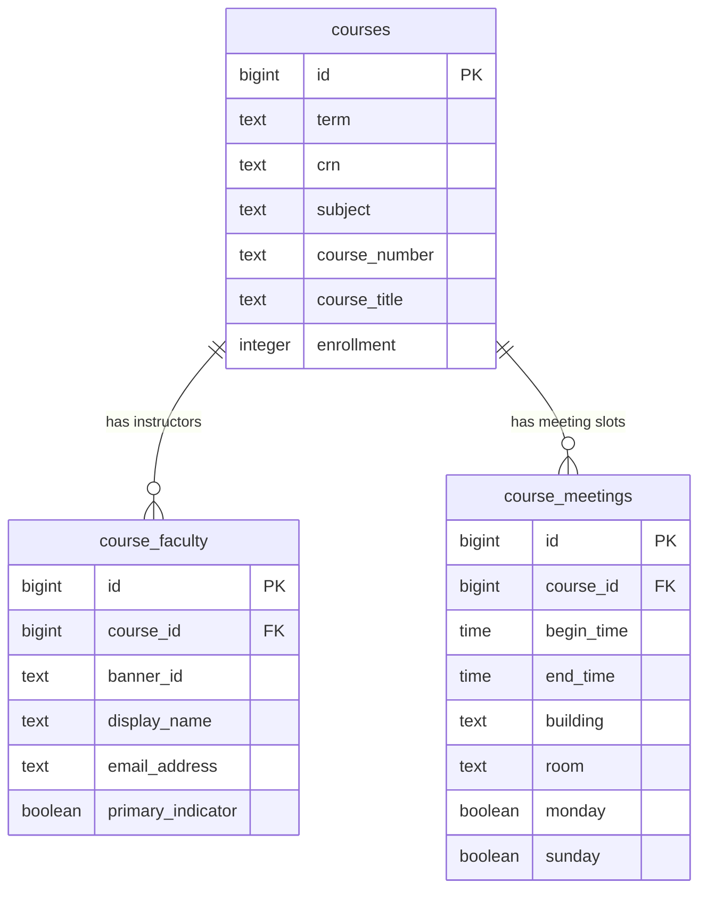

# Database

Supabase (Postgres). Three tables, all in the `public` schema, all populated from a
Banner course-schedule scrape.

The authoritative DDL lives in `python_scripts/schema.sql`, which is **gitignored**
along with the rest of `python_scripts/`. If you need to recreate the database, get
that file from the project owner; this document is the committed description of it.

## Relationships



Both child tables cascade on delete from `courses`.

## `courses`

One row per course **section** (not per course — the same course number can have
several sections with different CRNs).

| column | type | notes |
| --- | --- | --- |
| `id` | `bigint` PK | Banner's internal section id. **Not** the CRN. |
| `term` | `text` not null | Banner term code: `202609` = Fall 2026, `202701` = Winter 2027 |
| `crn` | `text` not null | Course Reference Number, e.g. `44778`. Human-facing section id. |
| `term_desc` | `text` | e.g. `Fall 2026` |
| `part_of_term` | `text` | e.g. `1` |
| `course_number` | `text` | e.g. `6000G` |
| `course_display` | `text` | usually identical to `course_number` |
| `subject` | `text` | e.g. `APBS` |
| `subject_description` | `text` | e.g. `Applied Bioscience` |
| `sequence_number` | `text` | |
| `campus_description` | `text` | e.g. `OT-North Oshawa` |
| `schedule_type_description` | `text` | e.g. `Lecture` |
| `course_title` | `text` | |
| `credit_hours` | `numeric(4,2)` | |
| `maximum_enrollment` | `integer` | |
| `enrollment` | `integer` | |
| `seats_available` | `integer` | |
| `wait_capacity` / `wait_count` / `wait_available` | `integer` | |
| `cross_list` | `text` | |
| `cross_list_capacity` / `cross_list_count` / `cross_list_available` | `integer` | |
| `credit_hour_high` / `credit_hour_low` | `numeric(4,2)` | |
| `credit_hour_indicator` | `text` | |
| `open_section` | `boolean` | |
| `link_identifier` | `text` | |
| `is_section_linked` | `boolean` | |
| `subject_course` | `text` | concatenated, e.g. `APBS6000G` |
| `instructional_method` | `text` | often null |
| `instructional_method_description` | `text` | often null |
| `updated_at` | `timestamptz` | defaults to `now()` |

Unique index on `(term, crn)` — treat that as the natural key. Indexes on `term`,
`subject`, `course_number`, `course_title`.

Earlier revisions of this table held `faculty` and `meetings` as `jsonb`; they are
now proper child rows. There is no jsonb in this schema.

## `course_faculty`

One row per instructor on a section.

| column | type | notes |
| --- | --- | --- |
| `id` | `bigint` identity PK | surrogate |
| `course_id` | `bigint` FK → `courses.id` | cascade delete |
| `term` | `text` not null | denormalised to allow per-term rebuilds |
| `banner_id` | `text` not null | instructor id, e.g. `35660` |
| `display_name` | `text` | `Surname, First` |
| `email_address` | `text` | |
| `category` | `text` | always null in current data |
| `primary_indicator` | `boolean` | `true` for the instructor of record |

Unique on `(course_id, banner_id, display_name)`. Indexes on `course_id`,
`banner_id`, `email_address`.

## `course_meetings`

One row per scheduled meeting slot. A section can have up to 12.

| column | type | notes |
| --- | --- | --- |
| `id` | `bigint` identity PK | surrogate |
| `course_id` | `bigint` FK → `courses.id` | cascade delete |
| `term` | `text` not null | denormalised to allow per-term rebuilds |
| `category` | `text` | **not unique per section** — up to 12 rows share `01` |
| `meeting_type` | `text` | e.g. `CLAS` |
| `meeting_type_description` | `text` | e.g. `Class` |
| `meeting_schedule_type` | `text` | e.g. `LEC`, `LAB` |
| `begin_time` / `end_time` | `time` | null for async/online sections |
| `start_date` / `end_date` | `date` | |
| `building` / `building_description` | `text` | e.g. `SCI` / `Science Building (SCI)` |
| `room` | `text` | e.g. `SCI3120` |
| `campus` / `campus_description` | `text` | e.g. `UON` / `OT-North Oshawa` |
| `credit_hour_session` | `numeric(4,2)` | often null |
| `hours_week` | `numeric(4,2)` | |
| `monday` … `sunday` | `boolean` not null | day-of-week flags |

Indexes on `course_id`, `(building, room)`, `begin_time`.

## Access rules

- RLS is enabled on all three tables with a `SELECT`-only policy for `anon` and
  `authenticated`. The Next.js app reads with `NEXT_PUBLIC_SUPABASE_ANON_KEY`.
- Writes require `SUPABASE_SERVICE_KEY` (`sb_secret_…` or the legacy `service_role`
  JWT). **Never** expose it to the client.
- `service_role` bypasses RLS but **not** table privileges. Any newly created table
  needs an explicit `GRANT` or writes fail with `42501 permission denied for table`.
- Identity columns also need `GRANT USAGE, SELECT ON ALL SEQUENCES`.

## Ingest

Source data is `courses.json` (Banner scrape, ~4,024 sections). Both the script and
the DDL are gitignored under `python_scripts/`.

```bash
cd python_scripts
python ingest_temp.py
```

The script:

1. drops json fields into typed rows, parsing `0910` → `09:10:00` and
   `09/08/2026` → `2026-09-08`
2. upserts `courses` on `id`
3. deletes `course_faculty` / `course_meetings` **for each term**, then re-inserts

Step 3 is what makes re-runs idempotent. If a section moves between terms, stale
child rows for the old term will linger.

`schema.sql` is a **reset** script — it drops all three tables before recreating
them. Only ever run it against a scratch project.

Because PostgREST caches the schema, `schema.sql` ends with
`notify pgrst, 'reload schema';`. If you add columns by hand and get
`PGRST204 ... schema cache`, send that same statement.

## Example queries

Sections with a Monday meeting, joined to instructor and room:

```sql
select c.subject, c.course_number, c.course_title,
       f.display_name, m.room, m.begin_time, m.end_time
from public.courses c
join public.course_meetings m on m.course_id = c.id
left join public.course_faculty f on f.course_id = c.id
where c.term = '202609'
  and m.monday
order by m.begin_time;
```

Open sections with seats remaining:

```sql
select term, subject, course_number, course_title, seats_available
from public.courses
where term = '202609' and open_section
order by seats_available desc;
```

Sections with no assigned instructor (~56% of the data):

```sql
select c.term, c.subject, c.course_number, c.course_title
from public.courses c
where not exists (
  select 1 from public.course_faculty f where f.course_id = c.id
);
```
