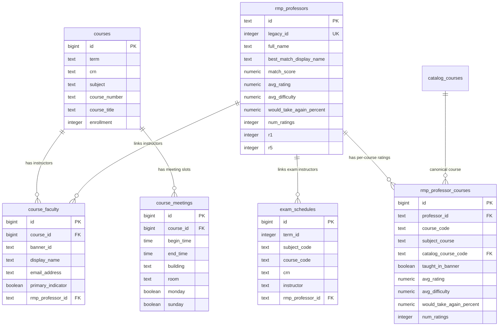

# Database

Supabase (Postgres), all in the `public` schema, populated from Banner course-schedule scrapes, Undergraduate Academic Calendar scrapes, campus map/booking feeds, and authenticated student data.

The authoritative DDL lives in [`supabase/migrations/`](../supabase/migrations/) —
fifteen committed, idempotent migrations. Apply them oldest first:

| migration | what it does |
| --- | --- |
| `20261028000000_baseline_courses_schema.sql` | creates `courses`, `course_faculty`, `course_meetings`, base indexes, grants and RLS policies |
| `20261028120000_search_optimizations.sql` | repairs HTML entities, adds the search indexes, refreshes planner statistics |
| `20261112000000_campus_map_schema.sql` | creates campus map tables (`campus_spaces`, `campus_unmapped_spaces`, `room_booking_details`, `library_study_rooms`, `room_detailed_reservations`, `campus_map_cache`) and `get_campus_map_data()` RPC |
| `20261112120000_degree_planner_schema.sql` | creates degree planner tables (`degree_subjects`, `catalog_courses`, `degree_programs`, `program_sections`, `program_groups`, `program_items`, `program_item_courses`) and `course_offerings_summary` view |
| `20261112180000_auth_and_student_courses.sql` | creates `@ontariotechu.net` `hook_before_user_created()` auth hook, `set_updated_at()`, `profiles` (with `handle_new_user()` trigger), and `student_courses` with user-scoped RLS |
| `20261112200000_degree_plans.sql` | creates `degree_plans` for per-user saved degree plans with user-scoped RLS |
| `20261113143000_degree_plans_columns.sql` | adds `degree_name` and `start_year` to `degree_plans` and orders `user_email`, `degree_name` first |
| `20261115000000_exam_schedules.sql` | creates `exam_schedules` and adds `booking_date` to `room_detailed_reservations` |
| `20261118000000_degree_catalog_years.sql` | adds `catalog_year` (e.g. `2026-27`, `2025-26`) to `degree_programs`, `catalog_courses`, and `degree_plans`, plus `(catalog_year, name, program_id)` index |
| `20261118120000_course_formerly_codes.sql` | adds `formerly_codes text[]` to `catalog_courses` to link renumbered courses (e.g. `CSCI 1050U` ↔ `CSCI 2050U`) |
| `20261119000000_campus_map_week_indexes.sql` | adds partial and composite indexes for weekly campus map schedule queries on `course_meetings`, `room_detailed_reservations`, `exam_schedules`, and `campus_spaces` |
| `20261119120000_course_offerings_summary_cache.sql` | backs `course_offerings_summary` with precomputed `course_offerings_summary_cache`, adds `refresh_course_offerings_summary()`, and indexes `degree_programs (catalog_year desc, name asc, program_id asc)` |
| `20261119120000_ratemyprof_schema.sql` | creates `rmp_professors` and `rmp_professor_courses`, links `course_faculty` and `exam_schedules` via `rmp_professor_id` FKs + auto-link triggers, and links `rmp_professor_courses` to `catalog_courses` |
| `20261120000000_degree_plans_minor.sql` | adds `minor_program_id text` to `degree_plans` so an attached minor persists with the saved plan |
| `20261120160000_profiles_onboarding.sql` | adds student onboarding columns (`year_of_study`, `degree_program_id`, `has_minor`, `minor_program_id`, `onboarding_completed_at`, `onboarding_skipped_at`) to `profiles` with FKs to `degree_programs`, backfills missing profiles, and adds student `INSERT` RLS |

```bash
# With the Supabase CLI
supabase link --project-ref <project-ref>
supabase db push
```

Without the CLI, paste each file into Dashboard → SQL Editor, oldest first.
`python_scripts/schema.sql` (gitignored) is a reset script for a scratch project
only — it is no longer the source of truth.

## Relationships



`course_faculty` and `course_meetings` cascade on delete from `courses`. `rmp_professor_courses` cascades on delete from `rmp_professors` (and sets `catalog_course_code` to null if removed from `catalog_courses`). `course_faculty.rmp_professor_id` and `exam_schedules.rmp_professor_id` set null on delete of a parent `rmp_professors` row.

## `courses`

One row per course **section** (not per course — the same course number can have
several sections with different CRNs).

| column | type | notes |
| --- | --- | --- |
| `id` | `bigint` PK | Banner's internal section id. **Not** the CRN. |
| `term` | `text` not null | Banner term code: `202609` = Fall 2026, `202701` = Winter 2027 |
| `crn` | `text` not null | Course Reference Number, e.g. `44778`. Human-facing section id. |
| `term_desc` | `text` | e.g. `Fall 2026` |
| `part_of_term` | `text` | e.g. `1` |
| `course_number` | `text` | e.g. `6000G` |
| `course_display` | `text` | usually identical to `course_number` |
| `subject` | `text` | e.g. `APBS` |
| `subject_description` | `text` | e.g. `Applied Bioscience` |
| `sequence_number` | `text` | |
| `campus_description` | `text` | e.g. `OT-North Oshawa` |
| `schedule_type_description` | `text` | e.g. `Lecture` |
| `course_title` | `text` | |
| `credit_hours` | `numeric(4,2)` | |
| `maximum_enrollment` | `integer` | |
| `enrollment` | `integer` | |
| `seats_available` | `integer` | |
| `wait_capacity` / `wait_count` / `wait_available` | `integer` | |
| `cross_list` | `text` | |
| `cross_list_capacity` / `cross_list_count` / `cross_list_available` | `integer` | |
| `credit_hour_high` / `credit_hour_low` | `numeric(4,2)` | |
| `credit_hour_indicator` | `text` | |
| `open_section` | `boolean` | |
| `link_identifier` | `text` | |
| `is_section_linked` | `boolean` | |
| `subject_course` | `text` | concatenated, e.g. `APBS6000G` |
| `instructional_method` | `text` | often null |
| `instructional_method_description` | `text` | often null |
| `updated_at` | `timestamptz` | defaults to `now()` |

Unique index on `(term, crn)` — treat that as the natural key.

Indexes:

| index | columns | serves |
| --- | --- | --- |
| `courses_term_crn_key` (unique) | `(term, crn)` | natural key |
| `courses_search_order_idx` | `(term, subject, course_number, crn)` | search filter **and** the `ORDER BY subject, course_number, crn LIMIT 10` — no sort step |
| `courses_term_class_type_idx` | `(term, schedule_type_description)` | class-type filter |
| `courses_term_idx` | `(term)` | redundant prefix of `courses_search_order_idx`; safe to drop |
| `courses_subject_idx`, `courses_course_number_idx` | single column | subject/course lookups without a term |
| `courses_crn_idx` | `(crn)` | CRN lookups for linking `exam_schedules` → `courses` → `course_faculty` |
| `courses_title_idx` | `(course_title)` | exact title lookups |

Earlier revisions of this table held `faculty` and `meetings` as `jsonb`; they are
now proper child rows. There is no jsonb in this schema.

## `course_faculty`

One row per instructor on a section.

| column | type | notes |
| --- | --- | --- |
| `id` | `bigint` identity PK | surrogate |
| `course_id` | `bigint` FK → `courses.id` | cascade delete |
| `term` | `text` not null | denormalised to allow per-term rebuilds |
| `banner_id` | `text` not null | instructor id, e.g. `35660` |
| `display_name` | `text` | `Surname, First` |
| `email_address` | `text` | |
| `category` | `text` | always null in current data |
| `primary_indicator` | `boolean` | `true` for the instructor of record |
| `rmp_professor_id` | `text` FK → `rmp_professors.id` | nullable (`on delete set null`); auto-populated by trigger when `display_name` matches a professor at `> 80%` |

Unique on `(course_id, banner_id, display_name)`. Indexes on `course_id`,
`banner_id`, `email_address`, `rmp_professor_id`, plus `(display_name, course_id)` for filtering
sections by instructor and `(term, display_name)` for the instructor suggestion
list.

## `course_meetings`

One row per scheduled meeting slot. A section can have up to 12.

| column | type | notes |
| --- | --- | --- |
| `id` | `bigint` identity PK | surrogate |
| `course_id` | `bigint` FK → `courses.id` | cascade delete |
| `term` | `text` not null | denormalised to allow per-term rebuilds |
| `category` | `text` | **not unique per section** — up to 12 rows share `01` |
| `meeting_type` | `text` | e.g. `CLAS` |
| `meeting_type_description` | `text` | e.g. `Class` |
| `meeting_schedule_type` | `text` | e.g. `LEC`, `LAB` |
| `begin_time` / `end_time` | `time` | null for async/online sections |
| `start_date` / `end_date` | `date` | |
| `building` / `building_description` | `text` | e.g. `SCI` / `Science Building (SCI)` |
| `room` | `text` | e.g. `SCI3120` |
| `campus` / `campus_description` | `text` | e.g. `UON` / `OT-North Oshawa` |
| `credit_hour_session` | `numeric(4,2)` | often null |
| `hours_week` | `numeric(4,2)` | |
| `monday` … `sunday` | `boolean` not null | day-of-week flags |

Indexes on `course_id`, `(building, room)`, `begin_time`.

## Access rules

- RLS is enabled on all three tables with a `SELECT`-only policy for `anon` and
  `authenticated`. The Next.js app reads with `NEXT_PUBLIC_SUPABASE_ANON_KEY`.
- Writes require `SUPABASE_SERVICE_KEY` (`sb_secret_…` or the legacy `service_role`
  JWT). **Never** expose it to the client.
- `service_role` bypasses RLS but **not** table privileges. Any newly created table
  needs an explicit `GRANT` or writes fail with `42501 permission denied for table`.
- Identity columns also need `GRANT USAGE, SELECT ON ALL SEQUENCES`.

## Ingest

Source data and ingest scripts live under `python_scripts/` (gitignored); the schema itself lives in `supabase/migrations/`.

### Course sections (`courses`, `course_faculty`, `course_meetings`)

```bash
cd python_scripts
python update_courses.py   # scrapes Banner into jsons/courses.json
python ingest_main.py      # upserts into Supabase
```

`ingest_main.py`:

1. drops json fields into typed rows, parsing `0910` → `09:10:00` and
   `09/08/2026` → `2026-09-08`
2. upserts `courses` on `id`
3. deletes `course_faculty` / `course_meetings` **for each term**, then re-inserts
4. runs `html.unescape()` over every text value — Banner ships `Lecture &amp; Lab`
   and `Women&#39;s Health`, which would otherwise render literally

Step 3 is what makes re-runs idempotent. If a section moves between terms, stale
child rows for the old term will linger.

### Degree planner (`degree_subjects`, `catalog_courses`, `degree_programs`, `program_*`)

```bash
python local/ingest_degrees.py             # ingests all years in local/jsons/years/{year}/degrees.json (oldest → newest)
python local/ingest_degrees.py --rebuild   # re-parses HTMLs for each year before ingesting
```

### Campus map, bookings & exams

Production-ready scripts that scrape and ingest directly into Supabase live under `python_scripts/`:

- `ingest_courses.py` — scrapes Banner via `banner_auth.py` and upserts `courses`, `course_faculty`, and `course_meetings`
- `ingest_lib_bookings.py` — scrapes library study rooms and upserts `library_study_rooms`
- `ingest_other_bookings.py` — scrapes Infosilem room details & reservations into `room_booking_details` and `room_detailed_reservations`
- `ingest_exam_schedule.py` — scrapes the exam schedule API into `exam_schedules`
- `ingest_ratemyprof.py` — matches Ontario Tech instructors against RateMyProfessors (`score > 80.0%`), upserts `rmp_professors` and `rmp_professor_courses`, and refreshes `rmp_professor_id` links daily (`.github/workflows/courses-and-exams.yml`)

(Legacy/local-only scratch scripts and JSON dumps live under gitignored `local/`.)

`schema.sql` is a **reset** script — it drops all three tables before recreating
them. It mirrors the baseline migration plus a wipe; only ever run it against a
scratch project. For anything real, use `supabase/migrations/`.

Because PostgREST caches the schema, both `schema.sql` and the baseline migration
end with `notify pgrst, 'reload schema';`. If you add columns by hand and get
`PGRST204 ... schema cache`, send that same statement.

Search-specific changes (entity repair + indexes) live in
[`supabase/migrations/20261028120000_search_optimizations.sql`](../supabase/migrations/20261028120000_search_optimizations.sql).
It is idempotent, so re-running it is harmless.

## Querying from the app

### The 1,000-row response cap

PostgREST returns **at most 1,000 rows** per request (`db-max-rows`), even if you
ask for `limit=5000`. A naive `select=subject` therefore returns only the first
1,000 sections — which is why it appears to have 23 distinct subjects instead of
56.

- Page with `.range(from, to)` for anything that needs every row.
- `collectPages()` in `src/lib/queries.ts` does this; it only requests 1,000 rows
  at a time by design.
- Never treat one response as "all rows".

### Suggestion lists

`getSearchVocab()` builds the four dropdown lists for the current term and caches
them for a day (`'use cache'`, tag `search-vocab`). Measured for `202609`:

| list | count |
| --- | --- |
| subjects | 56 |
| course codes | 693 |
| class types | 16 |
| instructor names | 436 |

That is ~18 KB in total, so the browser filters them locally and no query runs
per keystroke — a round trip to Supabase measures ~390 ms, which rules that out.

`'use cache'` functions may not read cookies, so these queries use
`src/lib/supabase/public.ts` (cookie-less anon client) rather than
`server.ts`.

### Ordering

Results are ordered `subject, course_number, crn`, limited to 10.

Every `course_number` is 4 digits + 1 letter (`1030U`, `6000G`), so text
ordering equals numeric ordering (`1030U < 2050U < 9000U`). If a shorter code
such as `900U` ever appears, plain text sort breaks and a numeric expression is
needed.

`crn` is the tiebreaker: several sections share the same `CSCI 1030U`, and
without it `LIMIT 10` can return a different set on each request.

`subject_course` is the concatenation **without** a space (`APBS6000G`), so user
input has to be normalised first — see `splitCourseCode()` in
`src/lib/queries.ts`.

### Filtering by instructor

`course_faculty` is a child table, so filtering by instructor needs the inner
join hint. Without `!inner` the embedded rows are filtered but every parent
section is still returned:

```ts
supabase
  .from("courses")
  .select("crn, course_faculty!inner(display_name)")
  .eq("course_faculty.display_name", "Banga, Janette");
```

### Text encoding

The scrape escapes HTML entities. `courses.course_title` contained 704 `&amp;`,
17 `&#39;` and 1 `&ndash;` before the repair in
`20261028120000_search_optimizations.sql`;
`schedule_type_description` contained `Lecture &amp; Lab`. The ingest now runs
`html.unescape()`, so re-ingesting produces clean text — do not re-introduce it
in any other pipeline.

## Campus Map tables

Created by `20261112000000_campus_map_schema.sql`. All publicly readable (`SELECT` for `anon`, `authenticated`).

- `campus_spaces` — map features (`id` PK, `geometry` jsonb, `building`, `floor`, `room_type`, `capacity`, `schedules`, `courses`, `all_courses`, `is_building_container`, `has_schedule`, `is_library_room`, etc.)
- `campus_unmapped_spaces` — non-polygonal reservation spaces (`room_id` PK)
- `room_booking_details` — room registry metadata (`room` PK, `campus`, `building`, `room_type`, `capacity`, `config_type`, `raw_data`)
- `library_study_rooms` — library group study rooms & bookings (`room_id` PK, `min_capacity`, `max_capacity`, `bookings` jsonb)
- `room_detailed_reservations` — calendar reservation occurrences (`id` identity PK, `room_id`, `day`, `start_time`, `duration`, `end_time`, `booking_date`, `title`, `type`)
- `exam_schedules` — final exam schedules (`id` PK, `term_id`, `subject_code`, `course_code`, `crn`, `instructor`, `rmp_professor_id` FK → `rmp_professors.id`, `exam_date`, `exam_time`, `duration`, `room`, `location`, `surname`, etc.), created by `20261115000000_exam_schedules.sql` and linked to `rmp_professors` by `20261119120000_ratemyprof_schema.sql`
- `campus_map_cache` — materialized GeoJSON `FeatureCollection` (`id` PK, `data` json)
- `get_campus_map_data(p_floor, p_building)` — RPC returning the cached `FeatureCollection` when unfiltered, or building it on the fly from `campus_spaces` + `campus_unmapped_spaces`.

## RateMyProfessors tables

Created by `20261119120000_ratemyprof_schema.sql`. All publicly readable (`SELECT` for `anon`, `authenticated`); written daily by `python_scripts/ingest_ratemyprof.py`.

### `rmp_professors`

One row per Ontario Tech RateMyProfessors profile matched to `course_faculty.display_name` with fuzzy `name_score > 80.0%` (same scoring algorithm as `local/tgraphql/temp.py`). Stores the headline rating shown beside an instructor's name plus overall breakdown metrics across all courses.

| column | type | notes |
| --- | --- | --- |
| `id` | `text` PK | RMP GraphQL node ID (e.g. `'VGVhY2hlci03NjE0Nzg='`) |
| `legacy_id` | `integer` unique | numeric RMP teacher ID (`ratemyprofessors.com/professor/<legacy_id>`) |
| `first_name` / `last_name` / `full_name` | `text` not null | name on RateMyProfessors |
| `department` / `department_id` | `text` | RMP department metadata |
| `best_match_display_name` | `text` | primary matched `course_faculty.display_name` (`Surname, First`) |
| `matched_display_names` | `text[]` not null | all Banner `display_name` strings matching this RMP profile at `> 80%` |
| `match_score` | `numeric(5,2)` not null | check `match_score > 80.0` |
| `avg_rating` | `numeric(3,2)` | overall quality rating (`0.00`–`5.00`, null when unrated) |
| `avg_difficulty` | `numeric(3,2)` | overall level of difficulty (`0.00`–`5.00`, null when unrated) |
| `num_ratings` | `integer` not null | total review count |
| `would_take_again_percent` | `numeric(5,2)` | `0.00`–`100.00`, null when no WTA responses exist |
| `would_take_again_count` | `integer` not null | denominator for `would_take_again_percent` |
| `r1` … `r5` | `integer` not null | review count at each star rating (`1` through `5`) |
| `updated_at` | `timestamptz` not null | defaults to `now()` |

Indexes on `(best_match_display_name)`, GIN on `(matched_display_names)`, and `(lower(last_name))`.

### `rmp_professor_courses`

One row per `(professor_id, course_code)` covering every course the professor offers in Banner (`courses` / `course_faculty`) as well as any additional courses present in their RateMyProfessors reviews. Selecting `"All courses"` reads directly from `rmp_professors`; selecting a specific course from the professor's dropdown reads the corresponding `rmp_professor_courses` row to dynamically update `r1`–`r5`, `would_take_again_percent`, `avg_difficulty`, `avg_rating`, and `num_ratings`.

| column | type | notes |
| --- | --- | --- |
| `id` | `bigint` identity PK | surrogate |
| `professor_id` | `text` FK → `rmp_professors.id` | cascade delete |
| `course_code` | `text` not null | normalized code with space (e.g. `'BIOL 1010U'`), or cleaned RMP code |
| `subject_course` | `text` not null | compact code without space (e.g. `'BIOL1010U'`) matching `courses.subject_course` |
| `course_title` | `text` | title from `catalog_courses` or `courses` when available |
| `catalog_course_code` | `text` FK → `catalog_courses.code` | nullable (`on update cascade on delete set null`) |
| `raw_course_codes` | `text[]` not null | raw RMP `class` strings merged into this course |
| `taught_in_banner` | `boolean` not null | `true` when the professor teaches this course in `public.courses` |
| `terms_taught` | `text[]` not null | Banner term codes taught (e.g. `{'202609', '202701'}`) |
| `avg_rating` / `avg_difficulty` | `numeric(3,2)` | course-specific quality & difficulty (null when `num_ratings = 0`) |
| `num_ratings` | `integer` not null | review count for this course |
| `would_take_again_percent` | `numeric(5,2)` | course-specific WTA % (null when `would_take_again_count = 0`) |
| `would_take_again_count` | `integer` not null | WTA-eligible review count for this course |
| `r1` … `r5` | `integer` not null | course-specific review count at each star rating (`1` through `5`) |
| `updated_at` | `timestamptz` not null | defaults to `now()` |

Unique on `(professor_id, course_code)`. Indexes on `(professor_id)`, `(subject_course, professor_id)`, and `(catalog_course_code)`.

### Professor table connections & auto-linking

- `course_faculty.rmp_professor_id` → `rmp_professors.id` (`on delete set null`). Trigger `course_faculty_link_rmp_professor` (`BEFORE INSERT OR UPDATE OF display_name`) calls `resolve_course_faculty_rmp_professor_id(display_name)` so per-term rebuilds in `ingest_courses.py` keep `rmp_professor_id` populated automatically.
- `exam_schedules.rmp_professor_id` → `rmp_professors.id` (`on delete set null`). Trigger `exam_schedules_link_rmp_professor` calls `resolve_exam_rmp_professor_id(...)`, resolving first via `(crn, subject_code, course_code)` in `courses` + `course_faculty`, then via course + surname, then via unambiguous `rmp_professors.last_name`.
- `refresh_rmp_professor_links()` (`service_role` RPC) bulk-syncs both FKs after daily `ingest_ratemyprof.py` updates.

## Degree Planner tables

Created by `20261112120000_degree_planner_schema.sql` and extended for multi-year catalogs by `20261118000000_degree_catalog_years.sql`. All publicly readable (`SELECT` for `anon`, `authenticated`).

- `degree_subjects` (`code` PK, `name`, `faculty`, `course_count`)
- `catalog_courses` (`code` PK, `catalog_year`, `formerly_codes`, `subject` FK → `degree_subjects.code`, `prerequisite_codes`, `prerequisite_ast`, `terms_offered`, etc.) — academic calendar definitions across all ingested years (`catalog_year` records the most recent year the course appeared in; `formerly_codes` links renumbered courses such as `CSCI 1050U` ← `CSCI 2050U`; older/retired courses are preserved alongside current ones), distinct from `public.courses` (Banner sections)
- `degree_programs` (`program_id` PK, `catalog_year`, `name`, `faculty`, `degree`, `total_credit_hours`, `required_course_codes`, etc.) — Ontario Tech's `poid` (`program_id`) is unique per `(program, catalog_year)`, so all calendar years (`2016-17` through `2026-27`) coexist cleanly, indexed on `(catalog_year, name, program_id)`
- `program_sections` → `program_groups` → `program_items` → `program_item_courses` (cascade-deleted hierarchy of degree requirements scoped by `program_id`)
- `course_offerings_summary_cache` (`subject_course` PK, `subject`, `course_number`, `terms`, `sections`, `credit_hours`, `updated_at`) — precomputed summary table populated from `public.courses` by `refresh_course_offerings_summary()` (service-role RPC, called after Banner ingestion).
- `course_offerings_summary` — view reading directly from `course_offerings_summary_cache` (so `getCourseOfferings()` does fast primary-key index lookups instead of live `GROUP BY` scans over `public.courses`).

## Auth & Student tables

Created by `20261112180000_auth_and_student_courses.sql`, `20261112200000_degree_plans.sql`, `20261113143000_degree_plans_columns.sql`, `20261118000000_degree_catalog_years.sql`, `20261120000000_degree_plans_minor.sql`, and `20261120160000_profiles_onboarding.sql`.

- `hook_before_user_created(event)` — Supabase Auth hook restricting sign-ups to `@ontariotechu.net`.
- `profiles` (`id` PK → `auth.users.id`, `email`, `full_name`, `avatar_url`, `year_of_study` smallint `1..4`, `degree_program_id` FK → `degree_programs.program_id`, `has_minor` boolean, `minor_program_id` FK → `degree_programs.program_id`, `onboarding_completed_at` timestamptz, `onboarding_skipped_at` timestamptz) — auto-populated on signup via `handle_new_user()`. RLS: users can `SELECT`/`INSERT`/`UPDATE` their own row.
- `student_courses` (`id` uuid PK, `user_id` → `auth.users.id`, `course_code`, `selected_crn`, `semester`, `status`, `grade`; unique `(user_id, course_code, semester)`). RLS: user-scoped CRUD.
- `degree_plans` (`user_email`, `degree_name`, `start_year`, `catalog_year`, `program_id`, `minor_program_id`, `terms` jsonb, `customs` jsonb, `user_id`, `id` uuid PK; unique `(user_email, program_id)`). RLS: user-scoped CRUD matching both `auth.uid()` and JWT `email`.

## Example queries

Sections with a Monday meeting, joined to instructor and room:

```sql
select c.subject, c.course_number, c.course_title,
       f.display_name, m.room, m.begin_time, m.end_time
from public.courses c
join public.course_meetings m on m.course_id = c.id
left join public.course_faculty f on f.course_id = c.id
where c.term = '202609'
  and m.monday
order by m.begin_time;
```

Open sections with seats remaining:

```sql
select term, subject, course_number, course_title, seats_available
from public.courses
where term = '202609' and open_section
order by seats_available desc;
```

Sections with no assigned instructor (~56% of the data):

```sql
select c.term, c.subject, c.course_number, c.course_title
from public.courses c
where not exists (
  select 1 from public.course_faculty f where f.course_id = c.id
);
```

Sections with the linked RateMyProfessors rating, overall breakdown, and per-course dropdown options (PostgREST / Supabase JS):

```ts
supabase
  .from("courses")
  .select(`
    crn,
    subject,
    course_number,
    course_faculty (
      display_name,
      primary_indicator,
      rmp_professors (
        id,
        legacy_id,
        full_name,
        avg_rating,
        avg_difficulty,
        num_ratings,
        would_take_again_percent,
        r1, r2, r3, r4, r5,
        rmp_professor_courses (
          course_code,
          subject_course,
          course_title,
          taught_in_banner,
          avg_rating,
          avg_difficulty,
          num_ratings,
          would_take_again_percent,
          r1, r2, r3, r4, r5
        )
      )
    )
  `)
  .eq("term", "202609");
```

Or in SQL for a specific professor's overall stats vs. a selected course from their dropdown:

```sql
select
  p.full_name,
  p.avg_rating            as overall_rating,
  p.avg_difficulty        as overall_difficulty,
  p.would_take_again_percent as overall_wta_pct,
  p.r1, p.r2, p.r3, p.r4, p.r5,
  pc.course_code,
  pc.course_title,
  pc.avg_rating           as course_rating,
  pc.avg_difficulty       as course_difficulty,
  pc.would_take_again_percent as course_wta_pct,
  pc.r1 as c_r1, pc.r2 as c_r2, pc.r3 as c_r3, pc.r4 as c_r4, pc.r5 as c_r5
from public.rmp_professors p
join public.rmp_professor_courses pc on pc.professor_id = p.id
where p.best_match_display_name = 'Tavares, Annette'
order by pc.taught_in_banner desc, pc.num_ratings desc, pc.course_code;
```
